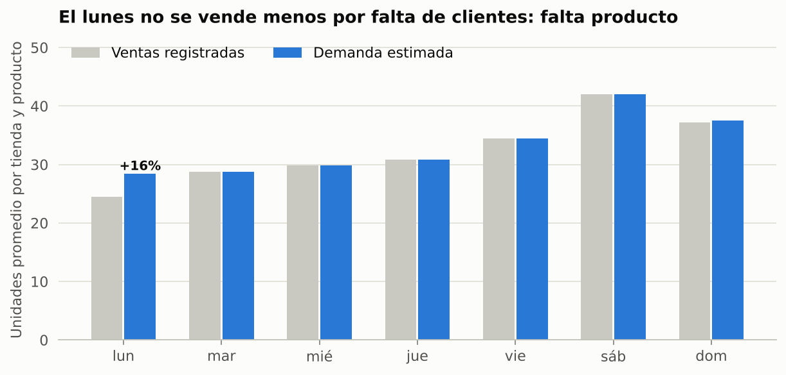
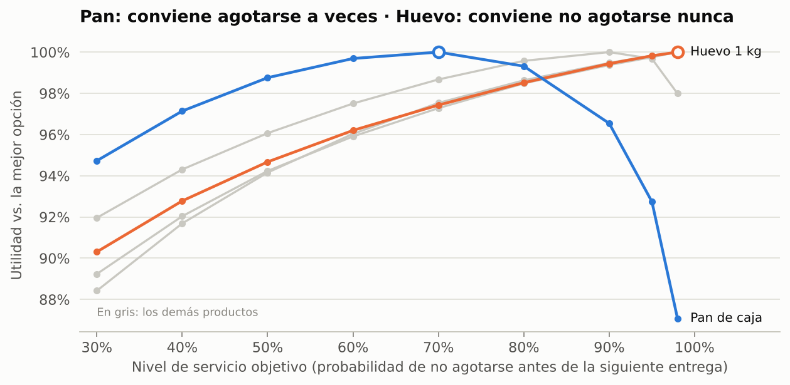
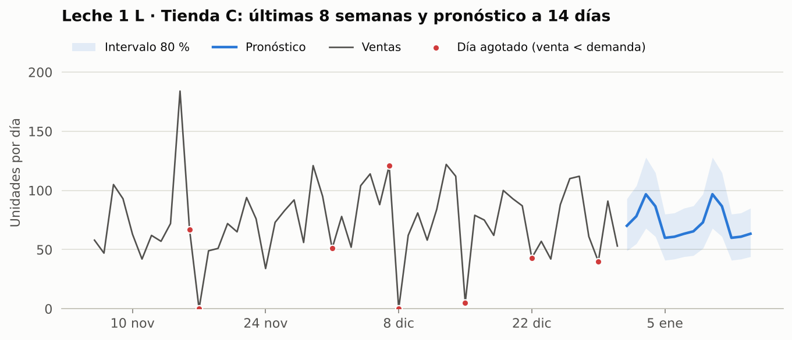
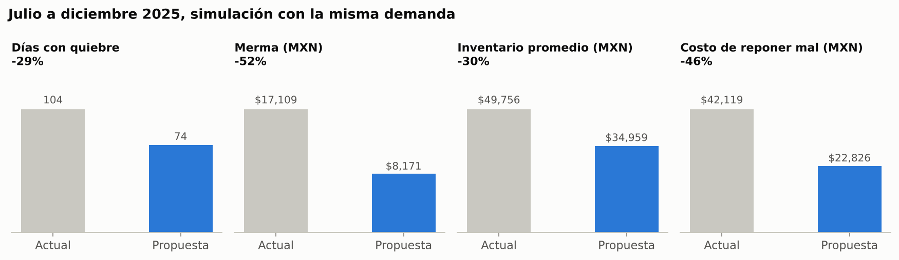
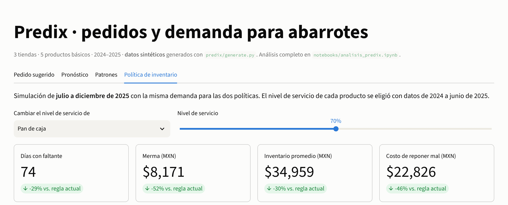

# Predix: demanda e inventario para abarrotes

**Cuánto pedir cada lunes y jueves en una tienda de abarrotes, a partir de la demanda real y no solo de lo que se alcanzó a vender.**

Python (pandas, statsmodels, SciPy) · binomial negativa censurada · simulación de inventario · Streamlit

> **Datos sintéticos.** Tres tiendas ficticias, cinco productos básicos, 2024–2025. `predix/generate.py` simula la demanda (día de la semana, quincena, diciembre, precio y crecimiento) y la operación con la regla de pedido actual del dueño, incluidas caducidad y faltantes. Las cifras no corresponden a ningún negocio real.

## Resumen ejecutivo

**Con la regla actual ("surtir hasta X piezas lunes y jueves"), en 6 de cada 10 lunes cada tienda se queda sin leche, pan o huevo antes de cerrar, y al mismo tiempo tira el 3 % del pan. Un pedido calculado con el pronóstico de demanda reduce 46 % el costo de reponer mal y libera 30 % del capital en inventario.**

| Indicador, julio a diciembre 2025 (simulación con la misma demanda) | Regla actual | Predix | Cambio |
|---|---|---|---|
| Unidades que se dejaron de vender | 2,195 | 831 | −62 % |
| Días con faltante (tienda × producto) | 104 | 74 | −29 % |
| Merma (MXN a costo) | 17,109 | 8,171 | −52 % |
| Inventario promedio (MXN a costo) | 49,756 | 34,959 | −30 % |
| **Costo de reponer mal** (margen perdido + merma + costo de inventario) | **42,119** | **22,826** | **−46 %** |



## Qué hace diferente este análisis

1. **Trata los faltantes como censura.** Un día agotado no dice "la demanda fue 40", sino "la demanda fue *al menos* 40". El modelo de demanda (binomial negativa) usa P(D ≥ venta) en esos días, una verosimilitud censurada al estilo Tobit para conteos. Como los datos son simulados se puede medir el sesgo de cada método:

   | Efecto | Valor real | Ventas como demanda | Excluyendo días agotados | **Censurado** |
   |---|---|---|---|---|
   | Sábado vs. lunes | 1.42 | 1.57 | 1.46 | **1.41** |
   | Elasticidad precio del huevo | −0.60 | −0.50 | −0.60 | **−0.60** |
   | Diciembre | 1.12 | 1.10 | 1.11 | **1.12** |

2. **Valida fuera de muestra.** Entrena con enero 2024 a junio 2025 y evalúa julio a diciembre 2025:

   | Pronóstico diario | WAPE | Sesgo |
   |---|---|---|
   | Mismo día de la semana pasada | 31.7 % | −0.7 % |
   | Promedio de 4 semanas | 25.4 % | −1.6 % |
   | Binomial negativa (ventas como demanda) | 22.3 % | −2.3 % |
   | **Binomial negativa censurada** | **22.1 %** | **−0.3 %** |

   Las ventas perdidas estimadas quedan a 6 % de las reales, que solo se conocen porque los datos son simulados.

3. **No usa un nivel de servicio único.** El nivel objetivo de cada pedido es la demanda pronosticada hasta la siguiente entrega más un colchón calculado con la varianza del modelo. El nivel de servicio de cada producto se elige por simulación (es el problema del *newsvendor*):
   - pan, que caduca en 5 días: ≈ 70 %;
   - leche: 90–95 %;
   - huevo, arroz y aceite: 98 %.

<p>
  
  
</p>



El análisis completo está en [`notebooks/analisis_predix.ipynb`](notebooks/analisis_predix.ipynb).

## Tablero

`streamlit_app.py` tiene cuatro pestañas:
- **Pedido sugerido:** para cada día de pedido, inventario al cierre, demanda esperada hasta la siguiente entrega, nivel objetivo y pedido sugerido frente al de la regla actual. Se descarga en CSV.
- **Pronóstico:** a 14 días con intervalo de 80 %, por tienda y producto.
- **Patrones:** día de la semana, quincena y todos los efectos del modelo.
- **Política de inventario:** simulación de las dos reglas, con un control para cambiar el nivel de servicio de cada producto.



## Cómo ejecutarlo

```bash
python -m venv .venv
.venv\Scripts\activate            # Windows · en macOS/Linux: source .venv/bin/activate
pip install -r requirements-dev.txt

python -m predix.generate          # opcional: regenera data/ (semilla fija)
pytest                             # 13 pruebas: datos, modelo e inventario
streamlit run streamlit_app.py
jupyter lab notebooks/analisis_predix.ipynb
```

## Estructura

```
├── predix/
│   ├── config.py      # tiendas, productos, calendario y supuestos
│   ├── generate.py    # demanda simulada + inventario FIFO con caducidad
│   ├── model.py       # binomial negativa censurada, pronóstico y métodos de referencia
│   ├── inventory.py   # regla actual, nivel objetivo dinámico, simulación y ajuste del nivel de servicio
│   └── plots.py
├── data/              # ventas_diarias.csv (10,965 filas) y catalogo.csv
├── notebooks/
├── reports/figures/
├── tests/
└── streamlit_app.py
```

`ventas_diarias.csv` tiene una fila por tienda, producto y día:
- `precio_mxn`
- `inventario_inicial`, después de recibir y retirar lo caducado
- `recibido`
- `merma`
- `ventas`
- `inventario_final`: si es 0, el producto se agotó y la venta es un mínimo de la demanda
- `pedido`, que llega al día siguiente

## Supuestos y limitaciones

- **Pedidos y entregas:** se pide los lunes y jueves y se recibe al día siguiente; el costo de mantener inventario es 25 % anual.
- **Ventas perdidas:** se asume que se pierden, sin que el cliente sustituya por otra marca. Si sustituye, el beneficio real es menor.
- **Alcance:** una tienda real tiene cientos de productos y promociones cruzadas. El método escala, pero los parámetros deben estimarse con datos propios.
- **Datos que conviene empezar a registrar:** la hora en que se agota cada producto. Con ese dato la demanda censurada se estima todavía mejor.

---

**Jesús R. L. González**: Analista y Científico de Datos · Operaciones y Calidad · [LinkedIn](https://www.linkedin.com/in/jesus-r-l-gonzalez)
